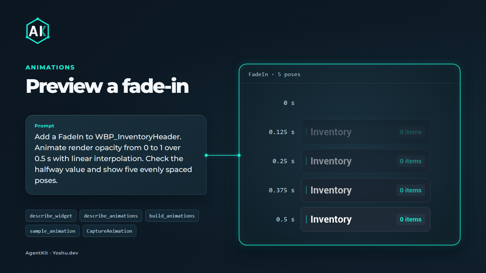

Usa AgentKit para crear animaciones UMG y revisar sus tiempos y apariencia. Empieza con un Widget Blueprint existente.

> En `WBP_InventoryHeader`, agrega una animación nueva llamada `FadeIn` que lleve la opacidad del encabezado de 0 a 1 en medio segundo, con interpolación lineal. Comprueba el valor a la mitad y muéstrame cinco poses a intervalos iguales.

1. El agente localiza el encabezado con `describe_widget` y revisa las animaciones existentes con `describe_animations`.
2. Usa `build_animations` para crear la transición, compilar y guardar el Widget Blueprint.
3. Usa `sample_animation` para comprobar que la opacidad sea 0.5 a un cuarto de segundo. Luego genera una cuadrícula PNG con `CaptureAnimation`.

Obtienes una transición que puedes reproducir en el diseñador de UMG y una hoja con las poses etiquetadas. Compara la hoja con el diseñador cuando necesites verificar la apariencia exacta.

Si la animación ya existe, pide al agente que revise los cambios con `diff_animation` antes de proponer un reemplazo. Consulta [Límites y seguridad](../../reference/limits/) para ver cómo AgentKit protege las ediciones manuales.

