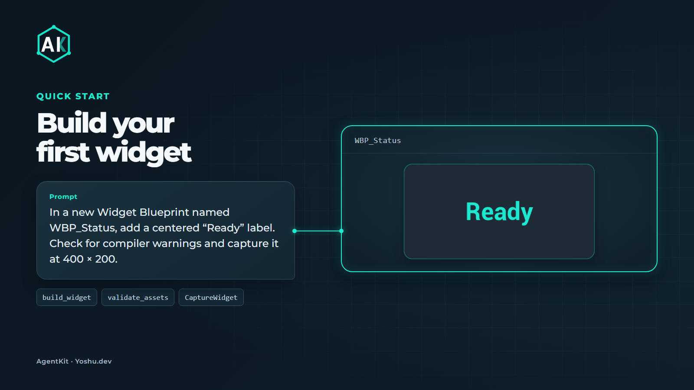

Once the editor is [connected to your MCP client](../connect-mcp/), try a small widget at a new asset path.

> In a new Widget Blueprint named `WBP_Status` under `/Game/AgentKitDemo`, add a centered “Ready” label. Use AgentKit, check for compiler warnings, and capture the widget at 400 by 200.

1. The agent builds, compiles, and saves the Widget Blueprint using `build_widget`.
2. It runs `validate_assets` and reports any diagnostics.
3. It uses `CaptureWidget` to render a PNG and shares the image or its location.

Open `WBP_Status` in the UMG Designer to review the result. Use the [widgets guide](../../guides/widgets/) to build a layout with more than one element.

