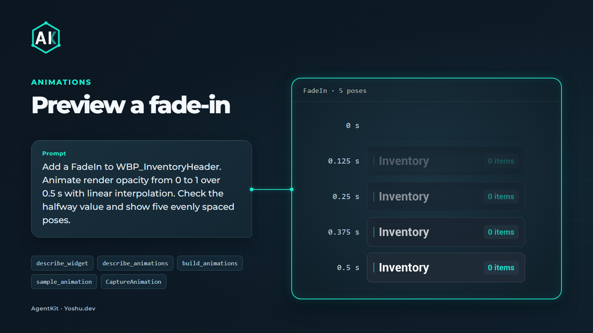

Use AgentKit to author UMG animations and review their timing and appearance. Start with an existing Widget Blueprint.

> In `WBP_InventoryHeader`, add a new animation named `FadeIn` that takes the header's render opacity from 0 to 1 over half a second, with linear interpolation. Check the halfway value and show me five evenly spaced poses.

1. The agent locates the header with `describe_widget` and checks the existing animations with `describe_animations`.
2. It uses `build_animations` to author the fade, compile, and save the Widget Blueprint.
3. It uses `sample_animation` to check that the opacity is 0.5 at a quarter of a second, then renders a PNG grid with `CaptureAnimation`.

You get a fade you can play in the UMG Designer and a labeled contact sheet for review. Compare the sheet with the Designer when the exact appearance matters.

For an existing animation, ask the agent to inspect changes with `diff_animation` before it proposes a replacement. See [Limits & safety](../../reference/limits/) for how AgentKit protects manual edits.

