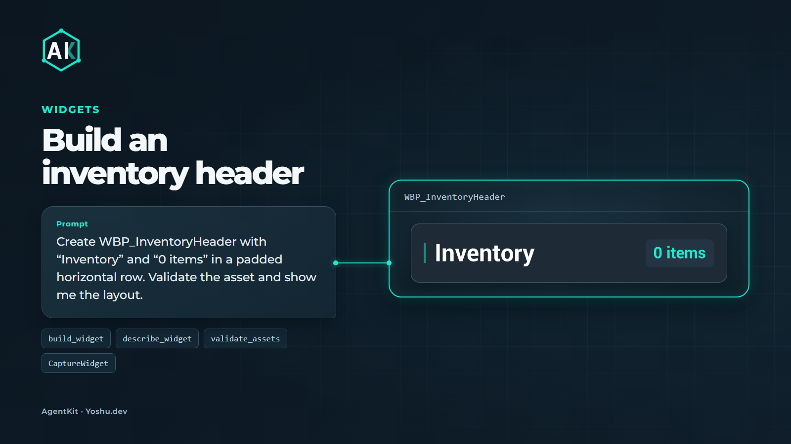

Use AgentKit to build a UMG layout, add Blueprint variables and supported graph logic, or inspect the layout of a Widget Blueprint you already have.

> Create `WBP_InventoryHeader` as a new Widget Blueprint under `/Game/AgentKitDemo`. Put “Inventory” and “0 items” in a padded horizontal row. Validate the asset and show me the layout.

1. The agent uses `build_widget` to create the row and its text widgets, then compiles and saves the Widget Blueprint.
2. It reads the resulting hierarchy and layout with `describe_widget`. It can skip graphs for a layout-only review.
3. It runs `validate_assets` for diagnostics and uses `CaptureWidget` to render the layout.

You get a Widget Blueprint you can open in the UMG Designer and a preview you can compare with the layout you requested.

